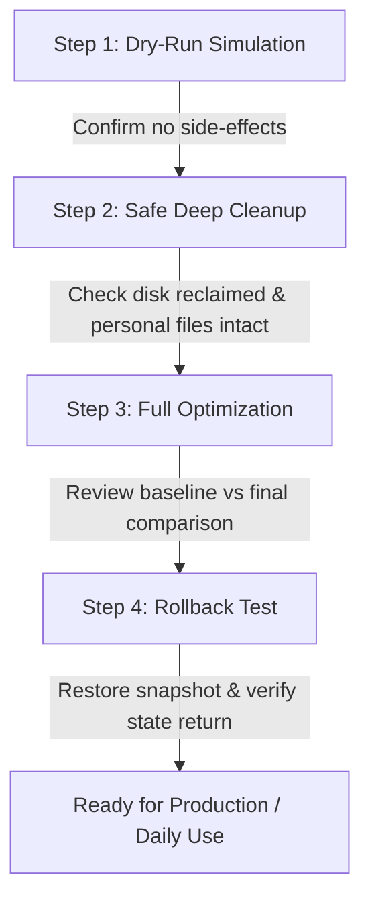

# ⚡ Windows Optimizer (v2.5.0)

<p align="center">
  <strong>Enterprise-Grade Performance Tuning, Safe Junk Purging & System Responsiveness Suite</strong>
  <br />
  <em>Engineered for Windows 10 (1909+) & Windows 11 (All Builds) • Powered by PowerShell 5.1+ / 7.x</em>
</p>

<p align="center">
  
  
  
  
  
  
</p>

---

## 📋 Table of Contents

- [Overview](#-overview)
- [The Core Philosophy: Engineering vs. Reckless Tweaking](#-the-core-philosophy-engineering-vs-reckless-tweaking)
  - [The `svchost.exe` Reality Check](#the-svchostexe-reality-check)
  - [The Myth of "RAM Cleaning"](#the-myth-of-ram-cleaning)
- [Feature Matrix](#-feature-matrix)
- [Detailed Module Breakdown](#-detailed-module-breakdown)
  - [1. Safe Deep Junk Cleanup](#1-safe-deep-junk-cleanup)
  - [2. Startup & Background Application Manager](#2-startup--background-application-manager)
  - [3. Categorized Windows Service Tuning](#3-categorized-windows-service-tuning)
  - [4. Gaming Latency & Scheduling Optimization](#4-gaming-latency--scheduling-optimization)
  - [5. Privacy & Start Menu Experience](#5-privacy--start-menu-experience)
  - [6. Rollback Engine & State Backups](#6-rollback-engine--state-backups)
- [Protected Whitelist Subsystems](#-protected-whitelist-subsystems)
- [Feature Comparison Table](#-feature-comparison-table)
- [Quick Start Guide](#-quick-start-guide)
  - [Method 1: Interactive Dashboard (Recommended)](#method-1-interactive-dashboard-recommended)
  - [Method 2: Command-Line Automation (CLI)](#method-2-command-line-automation-cli)
- [CLI Parameter Reference](#-cli-parameter-reference)
- [Directory Architecture](#-directory-architecture)
- [Safe Verification & Testing Workflow](#-safe-verification--testing-workflow)
- [Frequently Asked Questions (FAQ)](#-frequently-asked-questions-faq)
- [License](#-license)

---

## 💡 Overview

**Windows Optimizer** is an enterprise-grade performance tuning and system sanitization suite designed for power users, gamers, developers, and systems administrators.

Many open-source "debloaters" and "tweakers" take a sledgehammer to Windows: they mutilate core system components, permanently strip Windows Update, break printer and audio drivers, cripple Microsoft Store dependencies, and trigger anti-cheat bans.

**Windows Optimizer adheres to the principles of Senior Windows Systems Engineering:**
- **Zero Destruction**: Never deletes personal user files, browser profiles, saved credentials, or essential OS components.
- **Strict Subsystem Whitelisting**: Hardware audio, display drivers, networking stacks, Windows Security (Defender, SmartScreen), and anti-cheat engines (EasyAntiCheat, BattlEye, Vanguard) are strictly guarded.
- **Full Reversibility**: Automatically exports pre-modification states to JSON snapshots in `backups/`. Revert any configuration with a single keystroke.
- **Honest Metrics**: Operates strictly on verified operating system APIs and actual kernel scheduling principles—no fake "memory purgers" or dangerous working-set flushes.

---

## 🧠 The Core Philosophy: Engineering vs. Reckless Tweaking

### The `svchost.exe` Reality Check

A frequent concern among users upgrading to modern Windows is:
> *"Why does Windows 10/11 have 200–250 running processes when Windows 7 only had ~70?"*

#### The Architectural Shift
Starting in Windows 10 Creators Update (Build 1703), Microsoft redesigned the Service Host model for systems with **>3.5 GB of RAM**. Services that historically shared a monolithic `svchost.exe` process were split into **dedicated, isolated process instances**.

```
Monolithic Model (Windows 7 / Early Win 10)
[svchost.exe] ──> Hosts 15-20 different shared services concurrently
                  ⚠️ One service leak or crash takes down the entire group.

Modern Isolated Model (Windows 10 1703+ & Windows 11)
[svchost.exe #1] ──> Audio Endpoint Builder
[svchost.exe #2] ──> Network Location Awareness
[svchost.exe #3] ──> Windows Update Agent
                  🛡️ Complete fault isolation, granular telemetry, and sandbox security.
```

- **Process Count ≠ Resource Drain**: An idle, isolated `svchost.exe` process consumes `0.00%` CPU and negligible private memory.
- **The Realistic Target**: By trimming redundant 3rd-party background runners and disabling non-essential consumer telemetry, Windows Optimizer reduces total process count from **~220–250 down to a lean, rock-solid ~140–160** without breaking any core features.

### The Myth of "RAM Cleaning"

Third-party "RAM cleaners" and "Memory Boosters" abuse the Windows API `EmptyWorkingSet()` to forcibly eject process working sets into the system paging file (`pagefile.sys`).

```
⚠️ What "RAM Cleaners" Actually Do:
[Active RAM (Pre-warmed caches)] ──[EmptyWorkingSet()]──> [Paging File on Disk]
                                                                  │
Application Resumes Requesting Code & Assets <────────────────────┘
                  ⬇
  ⚠️ Massive Disk I/O Spikes, Micro-stutters & High Latency
```

Modern Windows uses **Standby RAM** to cache frequently used libraries, making application launches instant. Windows Optimizer **never** flushes working sets. Instead, it eliminates unneeded background processes at the root, ensuring physical RAM is naturally free for foreground games and productive workloads.

---

## ✨ Feature Matrix

| Capability | Module | Description | Reversible |
| :--- | :--- | :--- | :---: |
| **System Diagnostics** | `SystemHealth` | Live telemetry: CPU threads, RAM utilization, process counts, uptime, power plans | ℹ️ Read-Only |
| **Resource Inspector** | `Analyze` | Top 10 CPU & RAM consumers split into Windows Core vs 3rd-Party | ℹ️ Read-Only |
| **Safe Deep Junk Purge** | `Cleanup` | Cleans `%TEMP%`, WER dumps, CBS/DISM logs, shader caches, component store | 🟢 Safe |
| **Startup Optimizer** | `Startup` | Audits HKCU/HKLM Run keys, WOW6432Node, and Startup folders | 🔄 Yes (JSON) |
| **Background App Closer**| `Processes` | Gracefully closes unnecessary user apps; strictly protects critical processes | 🟢 Graceful |
| **Service Tuning** | `Services` | Category A (Safe telemetry/demo services) & Category B (Hardware optional) | 🔄 Yes (JSON) |
| **Gaming Profile** | `Gaming` | Verifies Windows Game Mode, HAGS, and suppresses micro-stutter triggers | 🔄 Yes (JSON) |
| **Privacy Hardening** | `Privacy` | Disables telemetry, ad IDs, timeline history, and Start Menu web search | 🔄 Yes (JSON) |
| **One-Click Pipeline** | `Full` | Unified baseline capture, deep cleanup, service tuning, and diff comparison | 🔄 Yes (JSON) |
| **Rollback Engine** | `Rollback` | 1-Click restoration of services, startup keys, and registry configurations | ⏪ Instant |
| **Audit Reporting** | `Report` | Generates a structured Markdown report summarizing performance gains | 📄 Generated |

---

## 🔍 Detailed Module Breakdown

### 1. Safe Deep Junk Cleanup
Reclaims gigabytes of disk space without touching user libraries (`Documents`, `Downloads`, `Desktop`, `Pictures`) or browser profile states.
- **User & System Temp**: `%TEMP%` and `%SystemRoot%\Temp` (gracefully skips active, locked file handles).
- **Crash & Diagnostic Dumps**: Windows Error Reporting (`WER`) archives and minidumps.
- **Servicing & Component Logs**: Old compressed CBS servicing logs and DISM transaction logs.
- **DirectX & GPU Shader Caches**: Purges stale D3D, NVIDIA, AMD, and Intel shader caches to resolve shader corruptions.
- **Delivery Optimization**: Clears redundant P2P Windows Update cache chunks.
- **DISM Component Store Cleanup**: Calls official `Dism.exe /Online /Cleanup-Image /StartComponentCleanup` to trim superseded Windows update packages.

### 2. Startup & Background Application Manager
- Analyzes both 64-bit and 32-bit registry autorun entries (`HKCU\Software\Microsoft\Windows\CurrentVersion\Run`, `HKLM\...`, `WOW6432Node`).
- Inspects user and global `Start Menu\Programs\Startup` directories.
- Allows disabling resource-heavy auto-launchers (Discord, Spotify, Adobe Creative Cloud, Epic Games Launcher, Steam) while keeping software fully functional on demand.

### 3. Categorized Windows Service Tuning
Services are transparently bifurcated into two risk tiers:

```
┌────────────────────────────────────────────────────────────────────────┐
│ WINDOWS SERVICES OPTIMIZATION                                          │
├──────────────────────────────────┬─────────────────────────────────────┤
│ Category A: 100% Safe            │ Category B: Advanced / Hardware     │
├──────────────────────────────────┼─────────────────────────────────────┤
│ • Connected User Experiences     │ • Print Spooler (spoolsv)           │
│   (DiagTrack Telemetry)          │   (Only disable if no printer used) │
│ • WAP Push Service               │ • Bluetooth Support (bthserv)       │
│ • Retail Demo Service            │   (Only disable if no BT hardware)  │
│ • Remote Registry                │ • SysMain / SuperFetch              │
│ • Downloaded Maps Broker         │ • Windows Search Indexer            │
│ • Xbox Background Services       │                                     │
│   (Configurable to Manual)       │ ⚠️ Requires explicit confirmation   │
└──────────────────────────────────┴─────────────────────────────────────┘
```

> [!NOTE]  
> Every service adjustment captures the original startup type (`Automatic`, `Manual`, `Disabled`) in `backups/backup_<timestamp>/services_backup.json` prior to execution.

### 4. Gaming Latency & Scheduling Optimization
- **Windows Game Mode**: Ensures OS game thread prioritization is engaged to maximize GPU and CPU affinity.
- **Hardware-Accelerated GPU Scheduling (HAGS)**: Inspects and guides proper WDDM 2.7+ GPU scheduling configuration.
- **Frame-Pacing Protection**: Identifies background user apps known to trigger timer resolution conflicts and micro-stutters during high-refresh-rate gaming.
- **Anti-Cheat Safe**: Completely shields kernel and user-mode anti-cheat binaries (`EasyAntiCheat`, `BattlEye`, `Riot Vanguard`).

### 5. Privacy & Start Menu Experience
- Sets Windows diagnostic data submission to the minimum supported baseline (Required/Basic).
- Disables the personalized Advertising Identifier across applications.
- **Start Menu Search Speedup**: Disables Bing web search integrations inside the Windows Start Menu, making search instant, local-only, and zero-telemetry.
- Disables consumer suggestions, lock screen promotional tiles, and timeline tracking.

### 6. Rollback Engine & State Backups
Every optimization session generates a dedicated backup folder:
```
backups/
└── backup_20261010_153000/
    ├── registry_backup.json    # Exact registry keys, types, and values
    ├── services_backup.json    # Pre-change service startup types & states
    └── startup_backup.json     # Pre-change startup item states
```
Selecting **Option [10]** in the interactive menu or passing `--rollback` opens an interactive picker of all previous sessions to restore your configuration instantly.

---

## 🛡️ Protected Whitelist Subsystems

Windows Optimizer embeds strict whitelists to ensure critical system stability:

### 🔒 Protected System Processes (Never Terminated)
```
system, idle, registry, smss, csrss, wininit, services, lsass, winlogon, svchost,
fontdrvhost, dwm, explorer, sihost, taskhostw, runtimebroker, searchhost,
startmenuexperiencehost, shellexperiencehost, conhost, cmd, powershell, pwsh,
spoolsv, audiodg, ctfmon, securityhealthservice, securityhealthsystray, msmpeng,
nissrv, smartscreen, memory compression, devenv, code, windowsterminal
```

### 🎮 Protected Hardware & Anti-Cheat Engines
```
# Graphics & Hardware
nvcontainer, nvsphelper64, nvidia share, radeonsoftware, amdrsserv, igfxem,
igfxdt, igfxcuiservice, realtekaudioservice, wavessvc

# Anti-Cheat Systems
easyanticheat, easyanticheat_eos, beservice, bedaisy, vgk, vgc
```

### ⚙️ Protected Windows Services (Never Modified)
```
RpcSs, RpcEptMapper, DcomLaunch, PlugPlay, SamSs, LSM, EventLog, Schedule,
ProfSvc, CryptSvc, StateRepository, CoreMessagingRegistrar, Power,
SystemEventsBroker, BrokerInfrastructure, TimeBrokerSvc, WinDefend, WdNisSvc,
SecurityHealthService, wscsvc, Sense, Dhcp, Dnscache, LanmanWorkstation,
LanmanServer, NlaSvc, netprofm, WlanSvc, WwanSvc, nsi, Netman, BFE, mpssvc,
AudioSrv, AudioEndpointBuilder, wuauserv, bits, dosvc, TrustedInstaller
```

---

## 📊 Feature Comparison Table

| Feature / Criteria | ⚡ Windows Optimizer | Aggressive "Debloaters" | Generic "RAM Cleaners" |
| :--- | :---: | :---: | :---: |
| **Maintains Windows Update** | ✅ **100% Protected** | ❌ Frequently broken | ➖ Irrelevant |
| **Preserves Windows Security / Defender**| ✅ **Untouched** | ❌ Often dismantled | ➖ Irrelevant |
| **Protects Anti-Cheat (EAC, BE, Vanguard)** | ✅ **Whitelisted** | ❌ Can trigger bans | ➖ Irrelevant |
| **Full 1-Click Rollback Engine** | ✅ **Native JSON backup** | ❌ Seldom reversible | ❌ None |
| **Zero EmptyWorkingSet / Disk Thrash** | ✅ **Engineered** | ⚠️ Sometimes used | ❌ Relies on it |
| **Dry-Run Simulation Mode** | ✅ **Included** | ❌ Rare | ❌ None |
| **Detailed Markdown Audit Reports** | ✅ **Included** | ❌ None | ❌ None |
| **UAC Elevation Broker & Non-Admin Mode** | ✅ **Graceful fallback**| ❌ Hard failure | ❌ Hard failure |

---

## 🚀 Quick Start Guide

### Prerequisites
- **Operating System:** Windows 10 (Version 1909 or newer) or Windows 11 (Any build)
- **Architecture:** 64-bit (x64 / ARM64) or 32-bit (x86)
- **Execution Engine:** PowerShell 5.1 (Built-in) or PowerShell 7.x

### Installation
Clone the repository or download the latest release archive:

```powershell
git clone https://github.com/your-username/WindowsOptimizer.git
cd WindowsOptimizer
```

---

### Method 1: Interactive Dashboard (Recommended)

1. Right-click [`WindowsOptimizer.bat`](file:///c:/Users/hamza/Desktop/Topics/WindowsOptimizer/WindowsOptimizer.bat) and choose **"Run as administrator"**.
2. If launched as a standard user, the built-in broker will prompt you to elevate or allow you to continue in safe user mode:

```text
================================================================================
   WINDOWS OPTIMIZER v2.5.0 - Professional Performance Engineering   
================================================================================
 >> Interactive Operations Dashboard
--------------------------------------------------------------------------------
  System Status Summary:
    OS: Microsoft Windows 11 Pro (Build 26100) | Admin: YES
    CPU: AMD Ryzen 9 7950X (32T) | RAM: 64.00 GB (22% used)
    Live Processes: 154 | Disk C: 124.50 GB Free
--------------------------------------------------------------------------------
  Select an operation:
   [1]  System Information and Health Check
   [2]  Analyze CPU, RAM, Disk, and Running Processes (Dry Run / Live)
   [3]  Safe Deep Junk Cleanup (Temp, Crash Reports, Shader Caches)
   [4]  Startup Applications Optimization
   [5]  Background Process Management (Graceful Non-Essential App Closer)
   [6]  Windows Services Optimization (Safe & Advanced Profiles)
   [7]  Gaming Optimization Profile (Game Mode & Background Suppressor)
   [8]  Optional Privacy Optimization (Telemetry & Start Menu Search)
   [9]  Full Safe Optimization Pipeline (Recommended Preset)
   [10] Restore Previous Changes (Rollback Engine)
   [11] Generate Optimization Report
   [12] Exit Optimizer

  Enter your choice [1-12]: 
```

---

### Method 2: Command-Line Automation (CLI)

Execute targeted operations directly via Command Prompt or PowerShell:

```cmd
:: Run non-destructive resource diagnostics
WindowsOptimizer.bat --analyze

:: Run safe junk cleanup
WindowsOptimizer.bat --cleanup

:: Execute full optimization preset
WindowsOptimizer.bat --full

:: Simulate actions without modifying disk or registry
WindowsOptimizer.bat --dry-run --full

:: Revert changes using the Rollback Engine
WindowsOptimizer.bat --rollback

:: Generate an exportable Markdown audit report
WindowsOptimizer.bat --report
```

Or call the PowerShell engine directly:
```powershell
powershell.exe -ExecutionPolicy Bypass -File .\WindowsOptimizer.ps1 -Full
```

---

## ⚙️ CLI Parameter Reference

| Flag (Batch) | Switch (PowerShell) | Description |
| :--- | :--- | :--- |
| `--analyze` | `-Analyze` | Performs deep resource, CPU/RAM, and junk storage diagnostics without modifying files. |
| `--cleanup` | `-Cleanup` | Purges temp directories, crash logs, shader caches, and component storage. |
| `--startup` | `-Startup` | Opens startup application inspector for registry and folder autoruns. |
| `--processes` | `-Processes` | Launches the non-essential background app manager. |
| `--services` | `-Services` | Runs the categorized service optimization module. |
| `--gaming` | `-Gaming` | Verifies Game Mode, HAGS status, and suppresses micro-stutter triggers. |
| `--privacy` | `-Privacy` | Applies telemetry reductions, ad ID disablement, and Start Menu search tweaks. |
| `--full` | `-Full` | Executes the complete safe optimization pipeline end-to-end. |
| `--rollback` | `-Rollback` | Opens the rollback menu to restore state from any prior session. |
| `--report` | `-Report` | Produces a detailed Markdown audit report in `reports/`. |
| `--dry-run` | `-DryRun` | Simulates all optimization routines without writing any changes to disk or registry. |
| `--help` | `-Help` | Prints syntax, options, and usage examples to console. |

---

## 📁 Directory Architecture

```
WindowsOptimizer/
│
├── WindowsOptimizer.bat     # Smart launcher, UAC elevation broker & argument dispatcher
├── WindowsOptimizer.ps1     # Core engine (diagnostics, cleanup, services, rollback)
├── README.md                # Comprehensive documentation & engineering guide
├── README.txt               # Plaintext legacy manual
│
├── backups/                 # Timestamped JSON snapshots of modified registry & services
│   └── backup_YYYYMMDD_HHMMSS/
│       ├── registry_backup.json
│       ├── services_backup.json
│       └── startup_backup.json
│
├── logs/                    # Granular execution logs with timestamps and status codes
│   └── optimizer_YYYYMMDD_HHMMSS.log
│
└── reports/                 # Auto-generated Markdown system audit and before/after reports
    └── Optimization_Report_YYYYMMDD_HHMMSS.md
```

---

## 🧪 Safe Verification & Testing Workflow

Follow this 4-step procedure to test and validate Windows Optimizer on any workstation:



1. **Step 1: Dry-Run Simulation**  
   Run `WindowsOptimizer.bat --dry-run` or select **[2] Analyze**. Verify that scans detect junk and calculate reclaimable space without modifying any file or registry key.
2. **Step 2: Run Deep Junk Cleanup**  
   Run **Option [3]**. Verify that disk space is freed while all personal folders (`Documents`, `Downloads`, browser logins) remain completely untouched.
3. **Step 3: Run Full Safe Optimization**  
   Run **Option [9]**. Observe baseline metrics, real-time status updates, and the final before-and-after comparison showing reclaimed storage and optimized background load.
4. **Step 4: Validate Rollback Engine**  
   Run **Option [10]**. Select the backup session created in Step 3 and confirm restoration. Confirm services and registry keys return cleanly to their initial states.

---

## ❓ Frequently Asked Questions (FAQ)

<details>
<summary><strong>Q: Why does the script recommend Administrator elevation?</strong></summary>
<br />
While system analysis and user-level temporary file cleanup work seamlessly under standard user accounts, modifying Windows services, executing DISM component cleanup, and clearing system temporary folders require administrative privileges. The launcher includes an automatic UAC elevation prompt for convenience.
</details>

<details>
<summary><strong>Q: Will this break Windows Update or Microsoft Store?</strong></summary>
<br />
<strong>No.</strong> Core servicing infrastructure (<code>wuauserv</code>, <code>bits</code>, <code>dosvc</code>, <code>TrustedInstaller</code>) is strictly hardcoded into the protected services whitelist and is never disabled or altered.
</details>

<details>
<summary><strong>Q: Will my games trigger anti-cheat warnings or bans?</strong></summary>
<br />
<strong>No.</strong> Unlike aggressive debloaters that terminate unknown background executables, Windows Optimizer strictly whitelists all major anti-cheat binaries including EasyAntiCheat (<code>easyanticheat.exe</code>), BattlEye (<code>beservice.exe</code>), and Riot Vanguard (<code>vgk.exe</code>, <code>vgc.exe</code>).
</details>

<details>
<summary><strong>Q: Why didn't my process count drop to 80 like Windows 7?</strong></summary>
<br />
Modern Windows 10/11 creates isolated <code>svchost.exe</code> processes for each system service when more than 3.5 GB of RAM is installed. A healthy, fully optimized Windows 10/11 installation runs approximately <strong>140–160 processes</strong> with near 0% idle CPU usage. Attempting to force lower counts by killing core OS components compromises security and reliability.
</details>

<details>
<summary><strong>Q: How do I completely undo all changes made by the tool?</strong></summary>
<br />
Launch <code>WindowsOptimizer.bat</code>, select <strong>Option [10] (Restore Previous Changes)</strong>, and pick the timestamp of the session you wish to revert. The Rollback Engine parses the stored JSON backups and restores all original service startup states and registry entries.
</details>

---

## 📄 License

This project is licensed under the [MIT License](LICENSE). You are free to use, modify, distribute, and integrate this software into enterprise or personal workflows with attribution.

---

<p align="center">
  <em>Developed with precision by a Senior Windows Performance Optimization Engineer.</em>
</p>
